# Architecture and flow diagrams

How the framework works, in pictures. GitHub renders these Mermaid diagrams in place; in VS Code use the Markdown preview with a Mermaid extension. The prose behind them is in [architecture.md](architecture.md), [security.md](security.md) and [monitoring.md](monitoring.md).

1. [The system on one page](#1-the-system-on-one-page)
2. [Layers inside the automation folder](#2-layers-inside-the-automation-folder)
3. [Where a skill gets its URLs, tokens and process](#3-where-a-skill-gets-its-urls-tokens-and-process)
4. [What happens on one command](#4-what-happens-on-one-command)
5. [Ticket to pull request](#5-ticket-to-pull-request)
6. [Gates: why "tests passed" always means this code](#6-gates-why-tests-passed-always-means-this-code)
7. [Approvals](#7-approvals)
8. [Authentication](#8-authentication)
9. [One monitoring pass](#9-one-monitoring-pass)
10. [Incident lifecycle](#10-incident-lifecycle)
11. [Defect to development handoff](#11-defect-to-development-handoff)
12. [Learning](#12-learning)

## 1. The system on one page

Two things start work: a developer in a Copilot CLI session, and Windows Task Scheduler. Both go through the same local command, `autodev`, and nothing else talks to the corporate systems.

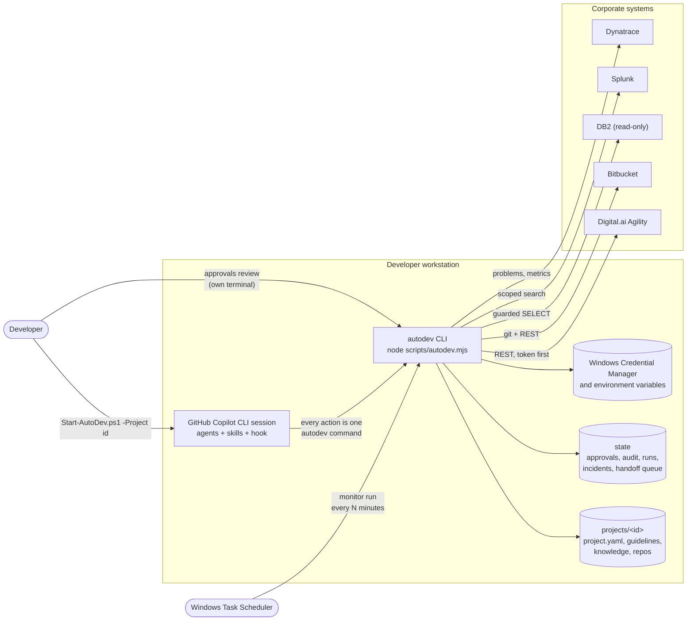

There is no server, no hosted component and no MCP. Copilot supplies the reasoning; `autodev` decides what is allowed.

## 2. Layers inside the automation folder

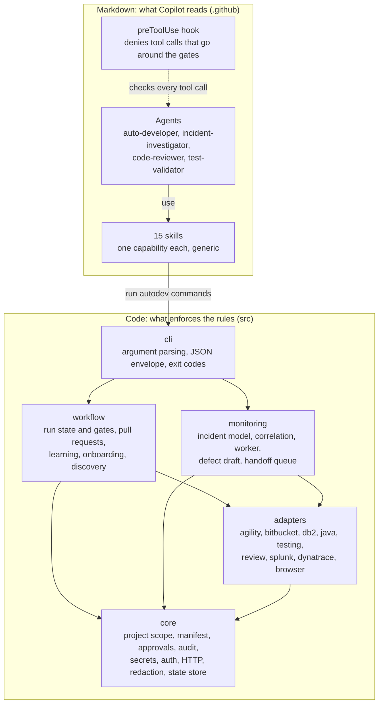

| Layer | Folder | Rule of thumb |
|---|---|---|
| Agents | `.github/agents` | Who coordinates. Four files, no capability logic. |
| Skills | `.github/skills` | How to use one capability. Generic: no URL, project name or team rule appears in a skill. |
| Hook | `.github/hooks`, `scripts/hooks` | A net under the agents: blocks direct `git push`, direct writes to `state\` and `knowledge\`, and similar. |
| CLI | `src/cli` | One command in, one JSON envelope out. |
| Workflow, monitoring | `src/workflow`, `src/monitoring` | The two business flows. |
| Adapters | `src/adapters` | One per external system; each returns the same shapes whatever the transport. |
| Core | `src/core` | Everything every command depends on. Scope, approvals and audit live here, so no adapter can skip them. |

## 3. Where a skill gets its URLs, tokens and process

Skills never contain company facts. When a skill runs a command, `autodev` puts the facts together from five places. Setting these up is what [setup.md](setup.md) walks through.

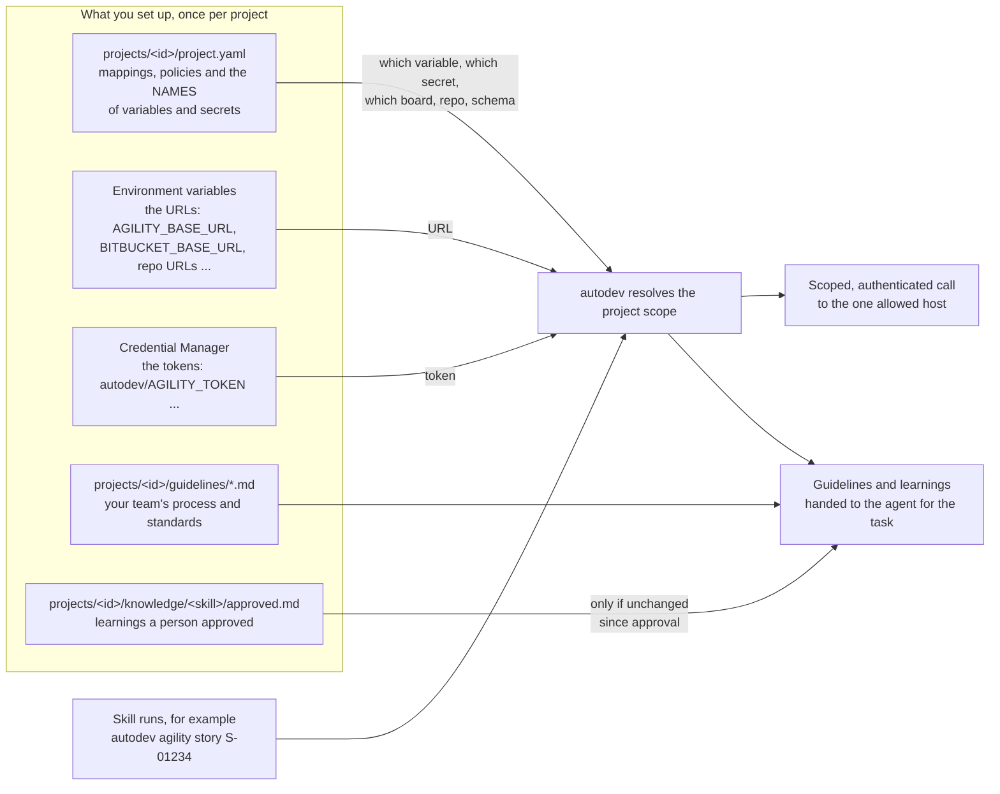

## 4. What happens on one command

Every command, from every skill, goes through the same checks in the same order.

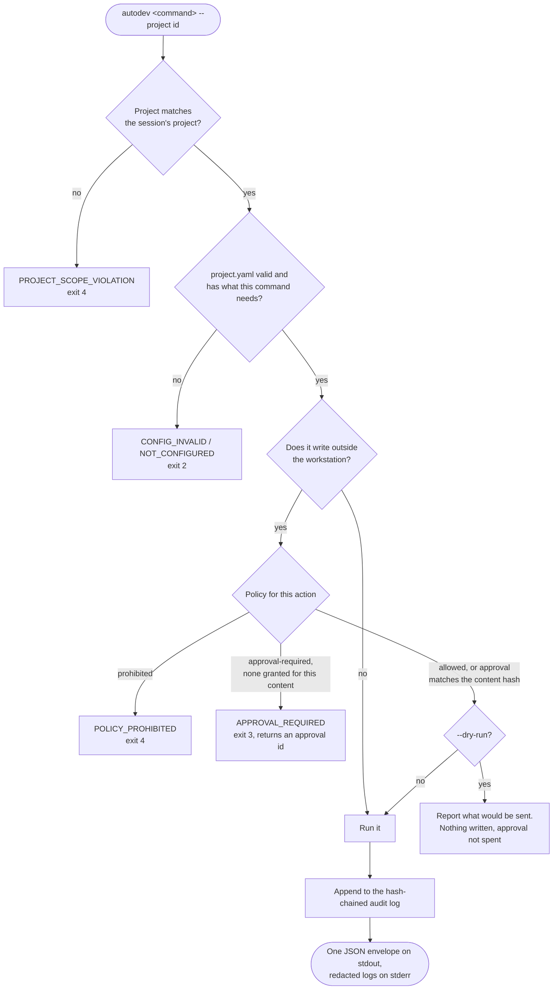

Exit codes: `0` success, `1` unexpected, `2` usage or configuration, `3` waiting on a person, `4` refused by policy or a gate, `5` upstream or transient.

## 5. Ticket to pull request

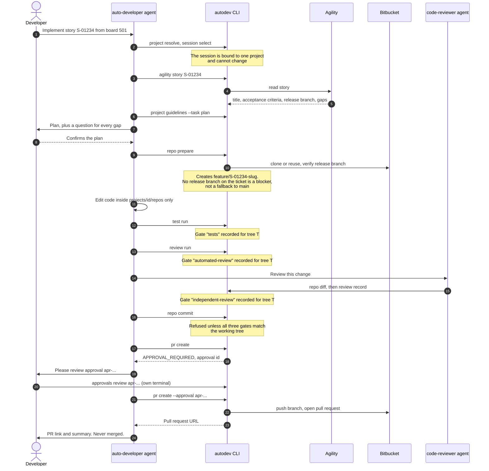

If any step changes the code after a gate was recorded, that gate no longer matches and has to be run again. See the next diagram.

## 6. Gates: why "tests passed" always means this code

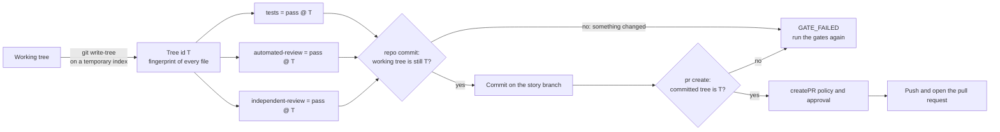

## 7. Approvals

An approval is for exact content. It is decided by a person at a real terminal, outside the Copilot session, and can be used once.

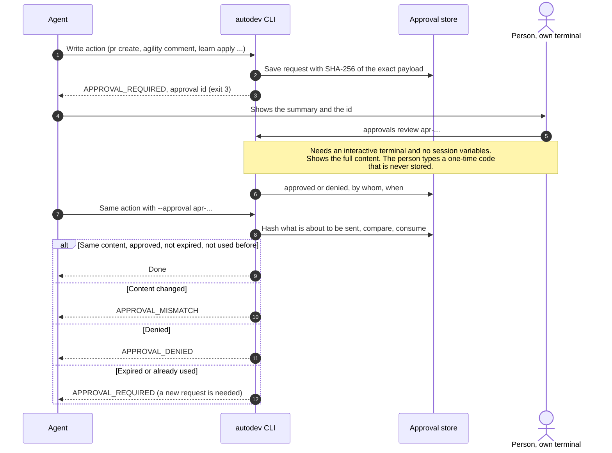

## 8. Authentication

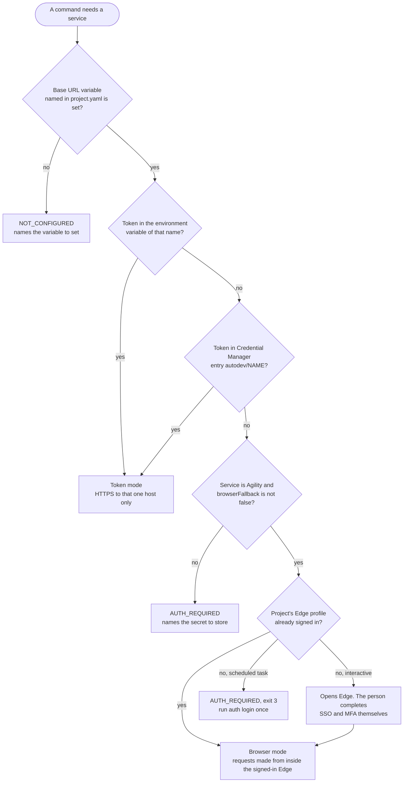

Never done on any path: typing a password, exporting cookies, automating MFA, ignoring a certificate error, following a redirect to a host that was not approved. DB2 authenticates natively through its stored connection string; `git` uses your own git credential setup.

## 9. One monitoring pass

The scheduled task runs this, bounded and restartable. It can be killed at any arrow and run again.

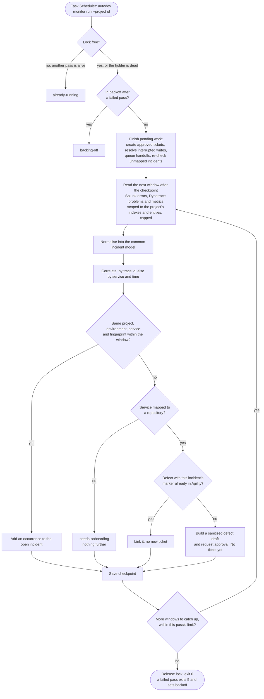

## 10. Incident lifecycle

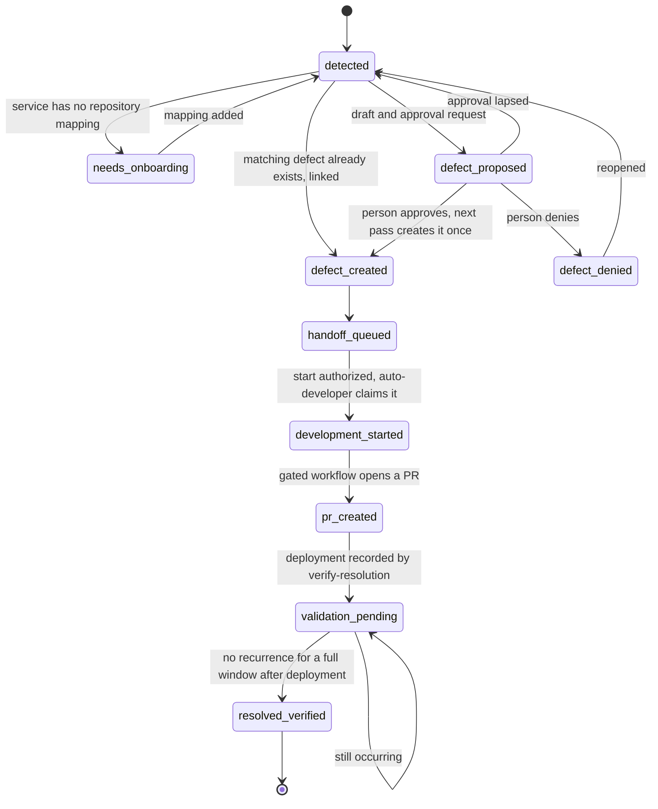

Any state can also move to `closed` with a reason (`autodev incident close`). State names use hyphens in the CLI (`defect-proposed`); underscores here are a Mermaid limitation. The transition table is a pure function in `src/monitoring/incident-model.js`; an invalid move is an error, not a silent no-op.

## 11. Defect to development handoff

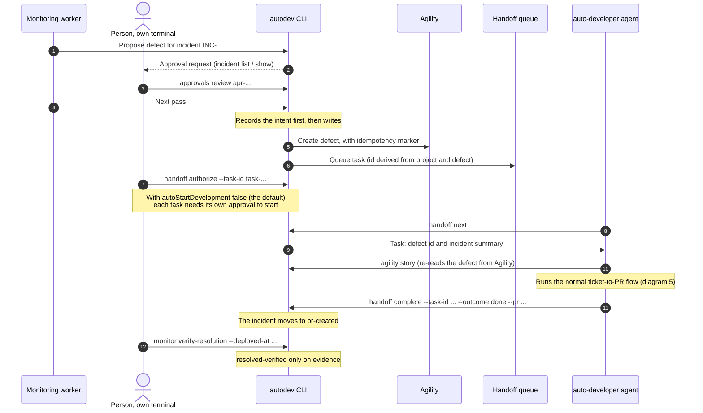

## 12. Learning

Nothing is remembered because an agent decided it should be.

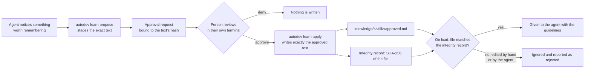
