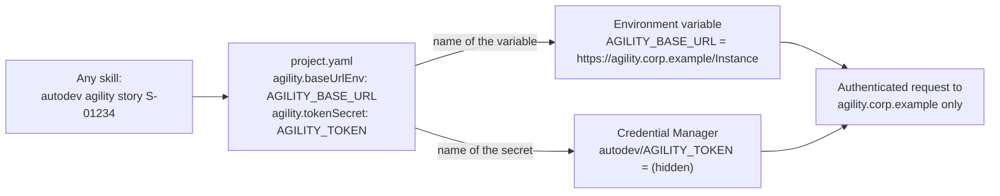

# Setup guide

From an empty Windows workstation to a first story, in order. Allow about an hour, most of it collecting facts and tokens from other teams.

> Nothing here has been run against a real corporate system yet. Each "verify" step below is the first real test of that integration in your environment; [unsupported.md](unsupported.md) records what is and is not proven. If a step fails, that is a finding to report, not something to work around.

## How configuration works

**You never edit a skill.** The 16 skills and 4 agents are generic and identical for every team. A skill learns your URLs, boards, repositories, schemas and process from five places that you set up once per project:

| What the skills need to know | Where you put it | How |
|---|---|---|
| **URLs** of Agility, Bitbucket, Splunk, Dynatrace and each repository | Windows environment variables | [Step 4](#step-4-set-the-urls) |
| **Tokens** and the DB2 connection string | Windows Credential Manager | [Step 5](#step-5-store-the-tokens) |
| **Mappings and policies**: which board, repositories, schemas and services belong to the project; what needs approval | `projects\<id>\project.yaml` | [Steps 3](#step-3-onboard-your-project) and [6](#step-6-complete-projectyaml) |
| **Process and standards**: how your team designs, codes, branches and tests | `projects\<id>\guidelines\*.md` | [Step 7](#step-7-write-down-your-process) |
| **Lessons learned** while working | `projects\<id>\knowledge\<skill>\approved.md` | Written by the framework after you approve each one; [Step 11](#step-11-let-it-learn-with-your-approval) |

`project.yaml` holds only the *names* of the variables and credential entries, never a URL with credentials and never a token. That is what lets the project folder be shared with your team.



More diagrams, including both workflows end to end, are in [diagrams.md](diagrams.md).

## Before you start: what to collect

Collect these first. Onboarding accepts partial answers and reports what is missing, but each gap blocks the feature that needs it.

| You need | Example | Who usually has it | Needed for |
|---|---|---|---|
| Agility base URL | `https://agility.corp.example/Instance` | Your browser's address bar | Reading stories |
| Agility team room (board) id and team name | `501`, `Orders Team` | The team room URL | Mapping a story to the project |
| Agility attribute names for acceptance criteria and release branch | `Custom_AcceptanceCriteria` | Agility administrator | Reading those fields. If the release branch is written in the description instead, a regex |
| Agility scope for new defects | `Scope:1234` | Agility administrator | Monitoring only |
| Agility access token | | Your Agility profile, "Applications" | Token access. Without one, Edge sign-in is used |
| Bitbucket flavour, base URL, project key | `server`, `https://bitbucket.corp.example`, `ORD` | A repository URL | Pull requests |
| Clone URL of each repository | `https://bitbucket.corp.example/scm/ord/service-api.git` | Bitbucket "Clone" button | Cloning |
| Bitbucket HTTP access token | | Bitbucket, "Manage account", "HTTP access tokens" | Opening pull requests |
| Build and test commands per repository | `mvnw.cmd -B test` | The team | The tests gate |
| DB2 read-only connection details and owned schemas | `APP`, `COMMON` | DBA | Schema lookups. Optional |
| Splunk base URL (management port), indexes, token | `https://splunk.corp.example:8089`, `app_nonprod` | Splunk administrator | Monitoring. Optional |
| Dynatrace environment URL, entity selectors, token | `https://abc12345.live.dynatrace.com` | Dynatrace administrator | Monitoring. Optional |
| Service to repository mapping | `orders-service` is built from `service-api` | The team | Routing incidents |
| Proxy and corporate CA details | | Network team | Only if calls fail; [corporate-network.md](corporate-network.md) |

Ask for least-privilege tokens: [secrets.md](secrets.md#least-privilege-per-token) says exactly which permissions each one needs.

## Step 1: Install the prerequisites

| Requirement | Check |
|---|---|
| Windows 10 or 11 | |
| PowerShell 7 (`pwsh`). Copilot CLI needs PowerShell 6 or later | `pwsh --version` |
| Node.js 22.12 or later | `node --version` |
| git, already able to clone from your Bitbucket | `git ls-remote <a repo URL>` |
| GitHub Copilot CLI, signed in | `npm install -g @github/copilot` or `winget install GitHub.Copilot`, then `copilot` and `/login` |
| Microsoft Edge | Installed on Windows by default |

`git` uses your existing git credentials (Git Credential Manager or SSH). The framework does not configure them.

## Step 2: Get the framework and bootstrap

The repository must sit at `<workspace>\automation`. The workspace root is its parent folder.

```powershell
mkdir C:\DevWorkspace
cd C:\DevWorkspace
git clone https://github.com/balapininti/Copilot-CLI-Auto-Developer.git automation
cd automation
.\scripts\Bootstrap.ps1
```

`Bootstrap.ps1` prints a PASS / WARN / FAIL table, creates `C:\DevWorkspace\projects` and `C:\DevWorkspace\state`, runs `npm ci`, then runs `autodev doctor` and `autodev discovery verify`. It installs nothing else and changes no machine setting. `-CheckOnly` validates without changing anything.

If scripts are blocked, run it for this one process: `powershell.exe -NoProfile -ExecutionPolicy Bypass -File .\scripts\Bootstrap.ps1`.

Behind a registry mirror or proxy, see [corporate-network.md](corporate-network.md#installing-packages-behind-a-registry-mirror) before `npm ci`.

Prove the install works, with no corporate access:

```powershell
node scripts\autodev.mjs demo e2e
```

Every check should be reported as passed. This runs both workflows against local mocks in a temporary folder.

In the rest of this guide `autodev` means `node scripts\autodev.mjs` (or `.\scripts\autodev.ps1`), run from `C:\DevWorkspace\automation`.

## Step 3: Onboard your project

```powershell
node scripts\autodev.mjs onboard-project
```

It asks for the facts in the table above. Press Enter to skip one. It contacts nothing and guesses nothing; a skipped answer is written as `null` and listed under `missing`.

To make the answers reviewable and repeatable, put them in a file instead ([onboarding.md](onboarding.md) lists every key):

```powershell
node scripts\autodev.mjs onboard-project --answers .\orders.answers.json --dry-run
node scripts\autodev.mjs onboard-project --answers .\orders.answers.json
```

Result:

```
C:\DevWorkspace\projects\orders\
  project.yaml
  guidelines\architecture.md  coding-standards.md  development-workflow.md  testing-standards.md
  knowledge\README.md
  repos\
```

Where it asks for a URL it wants the **name of an environment variable** (`AGILITY_BASE_URL`), not the URL. An answer that looks like a secret is refused.

## Step 4: Set the URLs

Set each variable that `project.yaml` names, at user level so that new terminals and the scheduled monitoring task see them:

```powershell
[Environment]::SetEnvironmentVariable('AGILITY_BASE_URL',     'https://agility.corp.example/Instance', 'User')
[Environment]::SetEnvironmentVariable('BITBUCKET_BASE_URL',   'https://bitbucket.corp.example', 'User')
[Environment]::SetEnvironmentVariable('SERVICE_API_REPO_URL', 'https://bitbucket.corp.example/scm/ord/service-api.git', 'User')
[Environment]::SetEnvironmentVariable('WEB_UI_REPO_URL',      'https://bitbucket.corp.example/scm/ord/web-ui.git', 'User')
# only if you use monitoring:
[Environment]::SetEnvironmentVariable('SPLUNK_BASE_URL',      'https://splunk.corp.example:8089', 'User')
[Environment]::SetEnvironmentVariable('DYNATRACE_BASE_URL',   'https://abc12345.live.dynatrace.com', 'User')
```

Open a new terminal afterwards. Rules:

- `https://` only. No user name or password in a URL.
- The variable names are yours to choose; they only have to match `project.yaml`. Two projects on one machine use different names (`ORDERS_AGILITY_BASE_URL`, `BILLING_AGILITY_BASE_URL`).
- Each service is reachable only at the host of its base URL. Repositories can be cloned only from hosts in `bitbucket.allowedHosts`.

See what the project may reach:

```powershell
node scripts\autodev.mjs service hosts --project orders
```

## Step 5: Store the tokens

Run these yourself in a normal PowerShell window. Each prompts with hidden input; the value never appears on a command line, in a file or in the agent's context.

```powershell
.\scripts\Set-AutoDevCredential.ps1 -Name AGILITY_TOKEN
.\scripts\Set-AutoDevCredential.ps1 -Name BITBUCKET_TOKEN
.\scripts\Set-AutoDevCredential.ps1 -Name SPLUNK_TOKEN               # monitoring only
.\scripts\Set-AutoDevCredential.ps1 -Name DYNATRACE_TOKEN            # monitoring only
.\scripts\Set-AutoDevCredential.ps1 -Name DB2_CONN_DB2_DEV_READONLY  # DB2 only; see db2.md
.\scripts\Set-AutoDevCredential.ps1 -List                            # names and dates, never values
```

| Service | Default secret name | Without it |
|---|---|---|
| Agility | `AGILITY_TOKEN` | Falls back to your signed-in Edge session (you complete SSO and MFA yourself) unless `agility.browserFallback: false` |
| Bitbucket REST | `BITBUCKET_TOKEN` | Pull requests cannot be opened by API: the branch is pushed and a pre-filled "create pull request" link is returned |
| Splunk | `SPLUNK_TOKEN` | `AUTH_REQUIRED`. No browser fallback |
| Dynatrace | `DYNATRACE_TOKEN` | `AUTH_REQUIRED`. No browser fallback |
| DB2 | `DB2_CONN_<PROFILE>` | `AUTH_REQUIRED`. No browser fallback |

`Set-AutoDevCredential.ps1` has been parsed and linted in CI but never executed; confirm with `-List` that the entry exists. The read path is verified. Storage, rotation and revocation are in [secrets.md](secrets.md).

To use Agility with no token:

```powershell
node scripts\autodev.mjs auth login --service agility --project orders
```

## Step 6: Complete project.yaml

Open `C:\DevWorkspace\projects\orders\project.yaml`. The commented reference is [examples/projects/sample-project/project.yaml](../examples/projects/sample-project/project.yaml); the schema is `schemas/project.schema.json`.

| Section | What to fill in | Which skills depend on it |
|---|---|---|
| `agility` | `boardId` or `boardIds`, `teamNames`, `fields.acceptanceCriteria`, `fields.releaseBranch` or `releaseBranchPattern`, `defectScope` | agility, project-context, workflow-handoff |
| `bitbucket` | `flavor` (`server` or `cloud`), `projectKey`, `allowedHosts` | bitbucket |
| `repositories[]` | `name`, `urlEnv`, `type` (`java-spring` or `ui`), `schemas`, `tests`, `branchPolicy` | bitbucket, java-spring, testing, code-review |
| `services[]` | Runtime service name and aliases, the repository it is built from, its schemas | incident-correlation, root-cause-analysis, workflow-handoff |
| `database` | `connectionProfile`, `schemas`, `maxRows`, `redactColumns` | db2 |
| `observability` | Names of the Splunk and Dynatrace URL variables and token secrets | splunk, dynatrace |
| `browser` | `allowedHosts`: your identity provider's hosts for SSO, and the UI under test | browser-playwright, authentication |
| `tests` | `required` stages and `timeoutMinutes` | testing |
| `branching` | `featurePattern`, `protected` | bitbucket |
| `policies` | What needs approval. Leave the defaults until you trust the setup | every skill that writes |
| `monitoring` | Off by default; [Step 10](#step-10-turn-on-monitoring-optional) | splunk, dynatrace, incident-correlation |

Things that are easy to get wrong:

- **Release branch.** The framework will not guess a base branch. Either name the Agility attribute that holds it (`agility.fields.releaseBranch`) or give a regex with one capture group that finds it in the description (`releaseBranchPattern: "Release branch:\\s*(\\S+)"`). A story with neither is a blocker and the agent asks you.
- **End-to-end tests** are configured the same way; see [End-to-end testing of your application](#end-to-end-testing-of-your-application).
- **Test commands are argument arrays**, run without a shell: `unit: [["mvnw.cmd", "-B", "test"]]`. Every stage in `tests.required` needs a command, or must be detectable for Maven or Gradle, otherwise the tests gate cannot pass.
- **A board maps to one project.** Two projects listing the same board make `project resolve` fail with `PROJECT_AMBIGUOUS`.
- **`services[]` drives monitoring.** An incident for a service that is not listed stops at `needs-onboarding`.
- **Policies cannot be loosened past the schema.** `productionChanges` can only be `prohibited`, and there is no setting that lets the framework merge or deploy. Keep `dbWrites: prohibited`: the DB2 adapter has no write path whatever the policy says.

## Step 7: Write down your process

The four files in `projects\orders\guidelines\` are how the agents learn your team's way of working. The agent loads the relevant ones before each kind of task:

| Task | Guidelines loaded |
|---|---|
| Planning a story | architecture, development-workflow |
| Implementing | architecture, coding-standards, development-workflow, testing-standards |
| Testing | testing-standards, development-workflow |
| Reviewing | coding-standards, architecture, testing-standards |
| Database work | architecture, coding-standards |
| Investigating an incident | architecture |

What belongs in each:

- **architecture.md**: modules and their responsibilities, layering rules, which service owns which table, integration points, what must not be touched.
- **coding-standards.md**: naming, error handling, logging, null handling, dependency rules, things reviewers always reject.
- **development-workflow.md**: branch naming, commit message format, pull request title and description template, required reviewers, the definition of done.
- **testing-standards.md**: what needs a unit test, the test naming convention, fixtures and test data, coverage expectations, how UI tests run.

Write them as short, specific rules ("Controllers never call repositories directly"), not essays. An empty section is reported to the agent as a gap and it asks; it is not filled with generic advice. Do not put secrets or customer data in them.

Check what an agent would receive:

```powershell
node scripts\autodev.mjs project guidelines --task implement --project orders
```

## Step 8: Validate, then verify each integration

```powershell
node scripts\autodev.mjs project validate --project orders   # what is still missing, and what each item is needed for
node scripts\autodev.mjs auth status      --project orders   # per service: token found? fallback? never prints a secret
```

Then one read-only call per integration, in this order. Stop at the first failure and fix it before continuing.

| # | Command | Proves |
|---|---|---|
| 1 | `autodev doctor` | Node, git, Copilot CLI, Edge, proxy and TLS settings |
| 2 | `autodev agility verify --project orders` | Agility is reachable and the account is recognised |
| 3 | `autodev agility story S-01234 --project orders` | Your field names are right. Check `acceptanceCriteria`, `releaseBranch` and `gaps` |
| 4 | `autodev repo prepare --story S-01234 --repo service-api --project orders --dry-run` | The repository URL is approved and the release branch exists |
| 5 | `autodev java detect --repo service-api --project orders` | The build tool and versions are detected (after a real `repo prepare`) |
| 6 | `autodev db2 tables --schema APP --project orders` | DB2 driver, connection and schema scope. Needs [db2.md](db2.md) first |
| 7 | `autodev splunk search --minutes 5 --project orders` | Splunk token and index scope |
| 8 | `autodev dynatrace problems --minutes 30 --project orders` | Dynatrace token and entity scope |

Every command prints one JSON object. `"ok": true` is success; otherwise `error.code` and `error.message` say what to fix. Common ones:

| Code | Meaning | Fix |
|---|---|---|
| `NOT_CONFIGURED` | A manifest field or the environment variable it names is not set | Set it (Steps 4 and 6); open a new terminal |
| `AUTH_REQUIRED` | No token, or the browser session is not signed in | Step 5, or `auth login` |
| `AUTH_FAILED`, `ACCESS_DENIED` | The token is wrong, expired or lacks permission | Reissue the token |
| `HOST_NOT_ALLOWED`, `REPO_URL_NOT_APPROVED` | A URL points at a host the project has not named | Correct the URL or add the host to the manifest |
| `NETWORK`, `TIMEOUT` | VPN, proxy or certificate | [corporate-network.md](corporate-network.md#troubleshooting-by-error-code) |
| `TLS_POLICY_VIOLATION` | Certificate checking was disabled | Remove `NODE_TLS_REJECT_UNAUTHORIZED=0`; install the corporate CA instead |

When a row succeeds against the real system, record it in [unsupported.md](unsupported.md) for your team.

## Step 9: Start a session

```powershell
cd C:\DevWorkspace\automation
.\scripts\Start-AutoDev.ps1 -Project orders
```

The launcher validates the project, checks that the agents and skills are discoverable, binds the session to the project and starts `copilot --agent auto-developer` in the automation folder. Copilot CLI finds agents and skills only in the folder it is started in (or in `~\.copilot` after `autodev discovery install`), which is why sessions go through the launcher.

First-session checks, because these have not been exercised in a signed-in session yet:

1. `/agent` lists `auto-developer`, `incident-investigator`, `code-reviewer`, `test-validator`.
2. `/skills list` shows the 16 skills.
3. Ask the agent to run `git push`. The hook should refuse it.

Then give it work:

> Implement story S-01234 from board 501.

The agent reads the story, tells you what is missing, proposes a plan and waits for your confirmation. When it reaches something that needs approval it gives you an id. Decide it in a **separate terminal**, where you see the exact content:

```powershell
node scripts\autodev.mjs approvals review apr-1a2b3c4d5e6f --project orders
```

Use `--dry-run` on any command, or ask the agent to work in dry-run, to see what would happen without anything being written.

For incident work: `.\scripts\Start-AutoDev.ps1 -Project orders -Agent incident-investigator`.

## Step 10: Turn on monitoring (optional)

Do this after the development workflow works. In `project.yaml` set `monitoring.enabled: true`, one `environment`, the Splunk `indexes`, the Dynatrace `entitySelectors`, and thresholds agreed with the owning team (a `null` threshold never fires). Then:

```powershell
node scripts\autodev.mjs monitor run --project orders --dry-run     # a pass that records nothing
.\scripts\Register-MonitoringTask.ps1 -Project orders -EveryMinutes 15
node scripts\autodev.mjs monitor status --project orders
```

The task runs as you, without elevation, and never opens a sign-in window. Details, the approval of proposed defects and the handoff to development are in [monitoring.md](monitoring.md).

## Step 11: Let it learn, with your approval

When the agent finds something worth keeping ("the integration profile needs Docker running"), it proposes a learning. You approve the exact text in your own terminal; only then is it written to `knowledge\<skill>\approved.md` and given to future sessions.

```powershell
node scripts\autodev.mjs learn list   --project orders
node scripts\autodev.mjs approvals review apr-… --project orders
node scripts\autodev.mjs learn verify --project orders
```

Do not edit `approved.md` by hand: a file that differs from what was approved fails its integrity check and is ignored. Standing team rules belong in `guidelines\`, which you edit freely.

## End-to-end testing of your application

The framework does not work out by itself how to start, deploy or test your application. It knows only what you tell it:

| What it needs to know | Where you say it |
|---|---|
| The command that runs your end-to-end suite | `repositories[].tests.e2e` in `project.yaml` |
| Whether a pull request depends on it | `tests.required` in `project.yaml` |
| Where the running application is, for browser checks | `browser.allowedHosts` in `project.yaml` |
| How your team does end-to-end testing: environments, test data, test users, what must be covered | `guidelines\testing-standards.md` |

There are three mechanisms, and they do different jobs.

**1. Your existing end-to-end suite, as a gated stage.** `autodev test run` runs the stages `compile`, `static`, `unit`, `integration`, `contract`, `regression` and `e2e`, in that order, using the commands you configured. The `e2e` command is whatever your team already uses (a Maven profile, a Playwright, Cypress or Selenium suite, an npm script). The command is responsible for starting the application or pointing at an environment where it runs.

```yaml
repositories:
  - name: web-ui
    urlEnv: WEB_UI_REPO_URL
    type: ui
    tests:
      compile: [["npm.cmd", "ci"], ["npm.cmd", "run", "build"]]
      unit:    [["npm.cmd", "test"]]
      e2e:     [["npm.cmd", "run", "e2e"]]      # your script starts the app, runs the suite, stops the app
tests:
  required: [compile, unit, e2e]                # add e2e here to make a pull request depend on it
  timeoutMinutes: 45
```

With `e2e` in `tests.required`, no pull request can be opened until it passes for the exact code being proposed. If it is required but has no command, the gate fails: a stage that cannot run has not passed.

**2. Browser checks written by the agent for the story.** Using the `browser-playwright` skill, the agent turns the story's acceptance criteria into a list of steps (open a page, fill, click, assert on text, take a screenshot) and runs them in Microsoft Edge with `autodev browser run --steps <file> --story S-01234`. Screenshots are kept as evidence under `state\evidence\<project>\<story>\` and the agent reports their paths. Clicking and typing are allowed only on hosts in `browser.allowedHosts`, so list the application under test there:

```yaml
browser:
  allowedHosts: [orders-dev.corp.example, login.corp.example]   # the app under test, and your identity provider
```

**3. Baseline scenarios built from a recording.** You run one journey in your browser, export a HAR, and give it to the agent. The framework keeps a sanitized outline of the calls the journey made; the agent uses the code base to work out the screens and selectors, tries the scenario in Edge, and proposes it for your approval. Approved scenarios are kept in `projects\<id>\scenarios\`, are re-run when a change touches the code they cover, and can only be changed with your approval. See [e2e-scenarios.md](e2e-scenarios.md).

Mechanisms 2 and 3 are evidence for you and the reviewer. They are **not** part of the tests gate; only `test run` is.

What the framework does not do:

- It does not start your application or deploy it to an environment. Your `e2e` command does, or the application is already running at a host you listed.
- It does not create test data or test users. Say in `testing-standards.md` which ones exist and how to reset them. DB2 access is read-only.
- It never types a password or completes MFA. If the application needs a sign-in, you complete it once in the project's Edge profile and the session is reused.
- It has no notion of environments for testing: it tests whatever host you list. List a development or test environment, never production.

So that the agent does this well, put in `testing-standards.md`: the URL of the environment to test against, how to start the application locally if that is the norm, which test accounts and data to use, and which user journeys must be checked for which kind of change.

## What each skill needs

No skill has its own configuration file. This table shows what must be in place for each to be useful.

| Skill | URL variable | Secret | `project.yaml` |
|---|---|---|---|
| project-context | | | The whole file; `guidelines` |
| agility | `agility.baseUrlEnv` | `AGILITY_TOKEN` or Edge sign-in | `agility.*` |
| bitbucket | `bitbucket.baseUrlEnv`, each `repositories[].urlEnv` | `BITBUCKET_TOKEN`; your own git credentials | `bitbucket.*`, `repositories[]`, `branching` |
| java-spring | | | `repositories[].type`, `tech` |
| testing | | | `repositories[].tests`, `tests` |
| code-review | | | `policies`, `securityRestrictions`, coding-standards guideline |
| db2 | In the connection string | `DB2_CONN_<PROFILE>` | `database.*`; `npm install ibm_db` |
| browser-playwright | | | `browser.*` |
| authentication | All of the above | All of the above | `agility.browserFallback`, `browser.allowedHosts` |
| splunk | `observability.splunkBaseUrlEnv` | `SPLUNK_TOKEN` | `monitoring.splunk`, `monitoring.limits` |
| dynatrace | `observability.dynatraceBaseUrlEnv` | `DYNATRACE_TOKEN` | `monitoring.dynatrace` |
| incident-correlation | | | `services[]`, `monitoring.correlation` |
| root-cause-analysis | | | `services[]`, `repositories[]` |
| workflow-handoff | | | `agility.defectScope`, `monitoring.incidentPolicy` |
| learning-management | | | `learning.persistence` |
| e2e-scenarios | | | `browser.allowedHosts` (the application under test), `repositories[]` |

## Setting up the rest of the team

Each developer repeats Steps 1, 2, 4, 5 and 8 on their own machine with their own tokens. Steps 3, 6 and 7 are done once:

- `project.yaml` and `guidelines\` contain no secrets, so keep `projects\<id>\` (without `repos\`) in a team repository and have everyone check it out under `C:\DevWorkspace\projects\`.
- Environment variable names must be the same for everyone, because the manifest refers to them by name. The values are the same too, unless people use different regions.
- `state\` is per machine and is never shared. That includes approvals and the integrity record for learnings, so a learning approved on one machine is not trusted on another until it is approved there.

## Updating and removing

```powershell
cd C:\DevWorkspace\automation
git pull
npm ci
node scripts\autodev.mjs discovery verify
```

If you ran `discovery install`, run it again after an update. To remove everything the framework placed on the machine, see [rollback.md](rollback.md).
