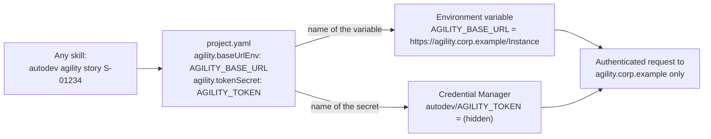

# Setup guide

From an empty Windows workstation to a first story, in order. Allow about an hour, most of it collecting facts and tokens from other teams.

| Step | What you do | Needed for |
|---|---|---|
| 1 to 2 | Install the prerequisites and the framework; run the demo | Everything |
| 3 | Onboard your project, by answering questions or by letting Copilot read what you already have | Everything |
| 4 to 5 | Set the URLs and store the tokens | Reaching your systems |
| 6 to 7 | Complete `project.yaml` and write down your team's process | Good plans, tests and reviews |
| 8 | Verify each integration with one read-only call | Trusting the setup |
| 9 to 10 | Start a session and take a first story to a pull request | Development |
| 11 | Record baseline end-to-end scenarios | Optional |
| 12 | Turn on monitoring | Optional |
| 13 | Approve the rules it proposes after each story, or opt in to saving them without review | Ongoing; learning is always on |

> Nothing here has been run against a real corporate system yet. Each "verify" step below is the first real test of that integration in your environment; [unsupported.md](unsupported.md) records what is and is not proven. If a step fails, that is a finding to report, not something to work around.

## What is in the box

Six agents, started with `Start-AutoDev.ps1 -Agent <name>`. You normally talk to the first one; it calls the reviewers itself.

| Agent | What it does | Start it |
|---|---|---|
| `auto-developer` | Takes a story to a pull request: reads the ticket, plans, implements, tests, opens the PR | `-Project <id>` (the default agent) |
| `plan-reviewer` | Evaluates the plan before any code, with findings ranked P0 to P4. Cannot edit | Called by `auto-developer`, or on its own with `-Agent plan-reviewer` |
| `code-reviewer` | Reviews the finished change and records the verdict that gates the PR. Cannot edit | Called by `auto-developer` |
| `test-validator` | Runs and interprets test stages | Called when needed |
| `incident-investigator` | Investigates what monitoring found and prepares defects. Never changes code | `-Project <id> -Agent incident-investigator` |
| `project-onboarder` | Builds a new project from clones, old skills and documents you point it at | `-Agent project-onboarder`, with no `-Project` |

Eighteen skills hold the how: one per capability (Agility, Bitbucket, DB2, testing, plan review, code review, end-to-end scenarios, onboarding, Splunk, Dynatrace and so on). Agents load them as they need them.

One command line, `autodev`, does the actual work and enforces the rules. Agents can only act through it.

## How configuration works

**You never edit a skill.** The 18 skills and 6 agents are generic and identical for every team. A skill learns your URLs, boards, repositories, schemas and process from six places that you set up per project:

| What the skills need to know | Where you put it | How |
|---|---|---|
| **URLs** of Agility, Bitbucket, Splunk, Dynatrace and each repository | Windows environment variables | [Step 4](#step-4-set-the-urls) |
| **Tokens** and the DB2 connection string | Windows Credential Manager | [Step 5](#step-5-store-the-tokens) |
| **Mappings and policies**: which board, repositories, schemas and services belong to the project; what needs approval | `projects\<id>\project.yaml` | [Steps 3](#step-3-onboard-your-project) and [6](#step-6-complete-projectyaml) |
| **Process and standards**: how your team designs, codes, branches and tests | `projects\<id>\guidelines\*.md` | [Step 7](#step-7-write-down-your-process) |
| **Lessons learned** while working | `projects\<id>\knowledge\<area>\approved.md` | Proposed by the agent at the end of every story; written after you approve each one; [Step 13](#step-13-let-it-learn-with-your-approval) |
| **Baseline end-to-end journeys** | `projects\<id>\scenarios\<name>.json` | Written by the framework after you approve each one; [Step 11](#step-11-record-baseline-end-to-end-scenarios-optional) |

`project.yaml` holds only the *names* of the variables and credential entries, never a URL with credentials and never a token. That is what lets the project folder be shared with your team.



More diagrams, including both workflows end to end, are in [diagrams.md](diagrams.md).

## Before you start: what to collect

Collect these first. Onboarding accepts partial answers and reports what is missing, but each gap blocks the feature that needs it.

| You need | Example | Who usually has it | Needed for |
|---|---|---|---|
| Agility base URL | `https://agility.corp.example/Instance` | Your browser's address bar | Reading stories |
| Agility team room (board) id and team name | `501`, `Orders Team` | The team room URL | Mapping a story to the project |
| Agility attribute names for acceptance criteria and release branch | `Custom_AcceptanceCriteria` | Agility administrator | Reading those fields. If the release branch is written in the description instead, a regex |
| Agility scope for new defects | `Scope:1234` | Agility administrator | Monitoring only |
| Agility access token | | Your Agility profile, "Applications" | Token access. Without one, Edge sign-in is used |
| Bitbucket flavour, base URL, project key | `server`, `https://bitbucket.corp.example`, `ORD` | A repository URL | Pull requests |
| Clone URL of each repository | `https://bitbucket.corp.example/scm/ord/service-api.git` | Bitbucket "Clone" button | Cloning |
| Bitbucket HTTP access token | | Bitbucket, "Manage account", "HTTP access tokens" | Opening pull requests |
| Build and test commands per repository | `mvnw.cmd -B test` | The team | The tests gate |
| DB2 read-only connection details and owned schemas | `APP`, `COMMON` | DBA | Schema lookups. Optional |
| Splunk base URL (management port), indexes, token | `https://splunk.corp.example:8089`, `app_nonprod` | Splunk administrator | Monitoring. Optional |
| Dynatrace environment URL, entity selectors, token | `https://abc12345.live.dynatrace.com` | Dynatrace administrator | Monitoring. Optional |
| Service to repository mapping | `orders-service` is built from `service-api` | The team | Routing incidents |
| Proxy and corporate CA details | | Network team | Only if calls fail; [corporate-network.md](corporate-network.md) |

Ask for least-privilege tokens: [secrets.md](secrets.md#least-privilege-per-token) says exactly which permissions each one needs.

## Step 1: Install the prerequisites

| Requirement | Check |
|---|---|
| Windows 10 or 11 | |
| PowerShell 7 (`pwsh`). Copilot CLI needs PowerShell 6 or later | `pwsh --version` |
| Node.js 22.12 or later | `node --version` |
| git, already able to clone from your Bitbucket | `git ls-remote <a repo URL>` |
| GitHub Copilot CLI, signed in | `npm install -g @github/copilot` or `winget install GitHub.Copilot`, then `copilot` and `/login` |
| Microsoft Edge | Installed on Windows by default |

`git` uses your existing git credentials (Git Credential Manager or SSH). The framework does not configure them.

## Step 2: Get the framework and bootstrap

The repository must sit at `<workspace>\automation`. The workspace root is its parent folder.

```powershell
mkdir C:\DevWorkspace
cd C:\DevWorkspace
git clone https://github.com/balapininti/Copilot-CLI-Auto-Developer.git automation
cd automation
.\scripts\Bootstrap.ps1
```

`Bootstrap.ps1` prints a PASS / WARN / FAIL table, creates `C:\DevWorkspace\projects` and `C:\DevWorkspace\state`, runs `npm ci`, then runs `autodev doctor` and `autodev discovery verify`. It installs nothing else and changes no machine setting. `-CheckOnly` validates without changing anything.

If scripts are blocked, run it for this one process: `powershell.exe -NoProfile -ExecutionPolicy Bypass -File .\scripts\Bootstrap.ps1`.

Behind a registry mirror or proxy, see [corporate-network.md](corporate-network.md#installing-packages-behind-a-registry-mirror) before `npm ci`.

Prove the install works, with no corporate access:

```powershell
node scripts\autodev.mjs demo e2e
```

Every check should be reported as passed. This runs both workflows against local mocks in a temporary folder.

In the rest of this guide `autodev` means `node scripts\autodev.mjs` (or `.\scripts\autodev.ps1`), run from `C:\DevWorkspace\automation`.

## Step 3: Onboard your project

There are two ways. Both produce the same folder, and neither contacts an external system.

| | Answer the questions yourself | Let Copilot read what you already have |
|---|---|---|
| Best when | You know the facts, or are starting from nothing | The repositories are already cloned, or you have an older skill, prompt file or runbook that describes the project |
| You do | Type answers, or write an answers file | Point it at files and folders, correct its findings, approve the result |
| Command | `autodev onboard-project` | `Start-AutoDev.ps1 -Agent project-onboarder` |

### Answer the questions yourself

```powershell
node scripts\autodev.mjs onboard-project
```

It asks for the facts in the table above. Press Enter to skip one. It contacts nothing and guesses nothing; a skipped answer is written as `null` and listed under `missing`.

To make the answers reviewable and repeatable, put them in a file instead ([onboarding.md](onboarding.md) lists every key):

```powershell
node scripts\autodev.mjs onboard-project --answers .\orders.answers.json --dry-run
node scripts\autodev.mjs onboard-project --answers .\orders.answers.json
```

Result:

```
C:\DevWorkspace\projects\orders\
  project.yaml
  guidelines\architecture.md  coding-standards.md  development-workflow.md  testing-standards.md
  knowledge\README.md
  repos\
```

Where it asks for a URL it wants the **name of an environment variable** (`AGILITY_BASE_URL`), not the URL. An answer that looks like a secret is refused.

### Let Copilot build it from what you already have

Copilot reads the files and folders you name and fills in most of the answers:

```powershell
.\scripts\Start-AutoDev.ps1 -Agent project-onboarder
```

Then: *"Onboard the orders project. The repositories are under C:\src\orders and my old skill is at C:\Users\me\.copilot\skills\orders."*

What happens:

1. It scans what you named: for each git clone, the remote URL, build tool, versions and test commands; from documents, the hosts they mention.
2. It shows you each fact with the file it came from, and a list of what it could not find. Correct it and answer what you can.
3. It proposes the whole project, including drafts of the guideline files. You review every file in your own terminal before anything is created:

   ```powershell
   node scripts\autodev.mjs approvals review apr-… --project orders
   ```
4. It creates the project exactly as approved, and gives you the commands for Step 4 with the URLs it found.

It reads only what you name, treats an old skill as information rather than instructions, never copies a token or password, and cannot set an approval policy. When you review, read the test commands, the allowed hosts and the drafted guideline text closely: those are what later sessions will run and follow. Details: [onboarding.md](onboarding.md#let-copilot-build-it-from-what-you-already-have).

To see what a scan would find before involving the agent: `node scripts\autodev.mjs onboard scan --path C:\src\orders`.

## Step 4: Set the URLs

Set each variable that `project.yaml` names, at user level so that new terminals and the scheduled monitoring task see them:

```powershell
[Environment]::SetEnvironmentVariable('AGILITY_BASE_URL',     'https://agility.corp.example/Instance', 'User')
[Environment]::SetEnvironmentVariable('BITBUCKET_BASE_URL',   'https://bitbucket.corp.example', 'User')
[Environment]::SetEnvironmentVariable('SERVICE_API_REPO_URL', 'https://bitbucket.corp.example/scm/ord/service-api.git', 'User')
[Environment]::SetEnvironmentVariable('WEB_UI_REPO_URL',      'https://bitbucket.corp.example/scm/ord/web-ui.git', 'User')
# only if you use monitoring:
[Environment]::SetEnvironmentVariable('SPLUNK_BASE_URL',      'https://splunk.corp.example:8089', 'User')
[Environment]::SetEnvironmentVariable('DYNATRACE_BASE_URL',   'https://abc12345.live.dynatrace.com', 'User')
```

Open a new terminal afterwards. Rules:

- `https://` only. No user name or password in a URL.
- The variable names are yours to choose; they only have to match `project.yaml`. Two projects on one machine use different names (`ORDERS_AGILITY_BASE_URL`, `BILLING_AGILITY_BASE_URL`).
- Each service is reachable only at the host of its base URL. Repositories can be cloned only from hosts in `bitbucket.allowedHosts`.

See what the project may reach:

```powershell
node scripts\autodev.mjs service hosts --project orders
```

## Step 5: Store the tokens

Run these yourself in a normal PowerShell window. Each prompts with hidden input; the value never appears on a command line, in a file or in the agent's context.

```powershell
.\scripts\Set-AutoDevCredential.ps1 -Name AGILITY_TOKEN
.\scripts\Set-AutoDevCredential.ps1 -Name BITBUCKET_TOKEN
.\scripts\Set-AutoDevCredential.ps1 -Name SPLUNK_TOKEN               # monitoring only
.\scripts\Set-AutoDevCredential.ps1 -Name DYNATRACE_TOKEN            # monitoring only
.\scripts\Set-AutoDevCredential.ps1 -Name DB2_CONN_DB2_DEV_READONLY  # DB2 only; see db2.md
.\scripts\Set-AutoDevCredential.ps1 -List                            # names and dates, never values
```

| Service | Default secret name | Without it |
|---|---|---|
| Agility | `AGILITY_TOKEN` | Falls back to your signed-in Edge session (you complete SSO and MFA yourself) unless `agility.browserFallback: false` |
| Bitbucket REST | `BITBUCKET_TOKEN` | Pull requests cannot be opened by API: the branch is pushed and a pre-filled "create pull request" link is returned |
| Splunk | `SPLUNK_TOKEN` | `AUTH_REQUIRED`. No browser fallback |
| Dynatrace | `DYNATRACE_TOKEN` | `AUTH_REQUIRED`. No browser fallback |
| DB2 | `DB2_CONN_<PROFILE>` | `AUTH_REQUIRED`. No browser fallback |

`Set-AutoDevCredential.ps1` has been parsed and linted in CI but never executed; confirm with `-List` that the entry exists. The read path is verified. Storage, rotation and revocation are in [secrets.md](secrets.md).

To use Agility with no token:

```powershell
node scripts\autodev.mjs auth login --service agility --project orders
```

## Step 6: Complete project.yaml

Open `C:\DevWorkspace\projects\orders\project.yaml`. The commented reference is [examples/projects/sample-project/project.yaml](../examples/projects/sample-project/project.yaml); the schema is `schemas/project.schema.json`.

| Section | What to fill in | Which skills depend on it |
|---|---|---|
| `agility` | `boardId` or `boardIds`, `teamNames`, `fields.acceptanceCriteria`, `fields.releaseBranch` or `releaseBranchPattern`, `defectScope` | agility, project-context, workflow-handoff |
| `bitbucket` | `flavor` (`server` or `cloud`), `projectKey`, `allowedHosts` | bitbucket |
| `repositories[]` | `name`, `urlEnv`, `type` (`java-spring` or `ui`), `schemas`, `tests`, `branchPolicy` | bitbucket, java-spring, testing, code-review |
| `services[]` | Runtime service name and aliases, the repository it is built from, its schemas | incident-correlation, root-cause-analysis, workflow-handoff |
| `database` | `connectionProfile`, `schemas`, `maxRows`, `redactColumns` | db2 |
| `observability` | Names of the Splunk and Dynatrace URL variables and token secrets | splunk, dynatrace |
| `browser` | `allowedHosts`: your identity provider's hosts for SSO, and the application under test | browser-playwright, authentication, e2e-scenarios |
| `tests` | `required` stages and `timeoutMinutes` | testing |
| `branching` | `featurePattern`, `protected` | bitbucket |
| `policies` | What needs approval, and `planReview` (below). Leave the defaults until you trust the setup | every skill that writes; plan-review |
| `learning` | `persistence`: `explicit-approval-only` (default) or `auto-save`. Leave the default at first; [Step 13](#saving-without-review-opt-in) | learning-management |
| `monitoring` | Off by default; [Step 12](#step-12-turn-on-monitoring-optional) | splunk, dynatrace, incident-correlation |

Things that are easy to get wrong:

- **Release branch.** The framework will not guess a base branch. Either name the Agility attribute that holds it (`agility.fields.releaseBranch`) or give a regex with one capture group that finds it in the description (`releaseBranchPattern: "Release branch:\\s*(\\S+)"`). A story with neither is a blocker and the agent asks you.
- **End-to-end tests** are configured the same way; see [End-to-end testing of your application](#end-to-end-testing-of-your-application).
- **Test commands are argument arrays**, run without a shell: `unit: [["mvnw.cmd", "-B", "test"]]`. Every stage in `tests.required` needs a command, or must be detectable for Maven or Gradle, otherwise the tests gate cannot pass.
- **A board maps to one project.** Two projects listing the same board make `project resolve` fail with `PROJECT_AMBIGUOUS`.
- **`services[]` drives monitoring.** An incident for a service that is not listed stops at `needs-onboarding`.
- **The plan gate is on by default.** `policies.planReview: required` means nothing is committed and no pull request is opened until the story's plan has been independently evaluated as ready. `advisory` keeps the evaluation but removes the hard stop. See [plan-review.md](plan-review.md).
- **The application under test must be listed.** End-to-end scenarios and browser checks may only click and type on hosts in `browser.allowedHosts`.
- **Three settings are yours alone.** `policies`, `learning.persistence` and `monitoring.enabled` decide how much the agents may do without you. No agent can change them, and onboarding always writes the restrictive value.
- **Policies cannot be loosened past the schema.** `productionChanges` can only be `prohibited`, and there is no setting that lets the framework merge or deploy. Keep `dbWrites: prohibited`: the DB2 adapter has no write path whatever the policy says.

## Step 7: Write down your process

The four files in `projects\orders\guidelines\` are how the agents learn your team's way of working. The agent loads the relevant ones before each kind of task:

| Task | Guidelines loaded | Approved learnings loaded with them |
|---|---|---|
| Planning a story, and evaluating the plan | architecture, development-workflow | plan-review, project-context, agility, bitbucket, db2, testing, code-review, workflow-handoff, authentication |
| Implementing | architecture, coding-standards, development-workflow, testing-standards | java-spring, bitbucket, db2, testing, plan-review |
| Testing | testing-standards, development-workflow | testing, browser-playwright, e2e-scenarios |
| Reviewing | coding-standards, architecture, testing-standards | code-review, java-spring, testing, db2 |
| Database work | architecture, coding-standards | db2 |
| Investigating an incident | architecture | splunk, dynatrace, incident-correlation, root-cause-analysis, db2, workflow-handoff, authentication |

Guidelines are what you write. Approved learnings are the rules the project has picked up along the way ([Step 13](#step-13-let-it-learn-with-your-approval)); they start empty and are delivered with the guidelines once you have approved some.

What belongs in each:

- **architecture.md**: modules and their responsibilities, layering rules, which service owns which table, integration points, what must not be touched.
- **coding-standards.md**: naming, error handling, logging, null handling, dependency rules, things reviewers always reject.
- **development-workflow.md**: branch naming, commit message format, pull request title and description template, required reviewers, the definition of done.
- **testing-standards.md**: what needs a unit test, the test naming convention, fixtures and test data, coverage expectations, how UI tests run.

Write them as short, specific rules ("Controllers never call repositories directly"), not essays. An empty section is reported to the agent as a gap and it asks; it is not filled with generic advice. Do not put secrets or customer data in them.

Check what an agent would receive:

```powershell
node scripts\autodev.mjs project guidelines --task implement --project orders
```

If the project was onboarded by the `project-onboarder` agent, these files may already contain drafted rules, each naming the file it came from. Read them and delete what you do not recognise: later agents follow them as your team's rules.

Sections you leave empty cost nothing. The agents receive the guidelines with empty sections and template text removed.

## Step 8: Validate, then verify each integration

```powershell
node scripts\autodev.mjs project validate --project orders   # what is still missing, and what each item is needed for
node scripts\autodev.mjs auth status      --project orders   # per service: token found? fallback? never prints a secret
```

Then one read-only call per integration, in this order. Stop at the first failure and fix it before continuing.

| # | Command | Proves |
|---|---|---|
| 1 | `autodev doctor` | Node, git, Copilot CLI, Edge, proxy and TLS settings |
| 2 | `autodev agility verify --project orders` | Agility is reachable and the account is recognised |
| 3 | `autodev agility story S-01234 --project orders` | Your field names are right. Check `acceptanceCriteria`, `releaseBranch` and `gaps` |
| 4 | `autodev repo prepare --story S-01234 --repo service-api --project orders --dry-run` | The repository URL is approved and the release branch exists |
| 5 | `autodev java detect --repo service-api --project orders` | The build tool and versions are detected (after a real `repo prepare`) |
| 6 | `autodev db2 tables --schema APP --project orders` | DB2 driver, connection and schema scope. Needs [db2.md](db2.md) first |
| 7 | `autodev splunk search --minutes 5 --project orders` | Splunk token and index scope |
| 8 | `autodev dynatrace problems --minutes 30 --project orders` | Dynatrace token and entity scope |

Every command prints one JSON object. `"ok": true` is success; otherwise `error.code` and `error.message` say what to fix. Common ones:

| Code | Meaning | Fix |
|---|---|---|
| `NOT_CONFIGURED` | A manifest field or the environment variable it names is not set | Set it (Steps 4 and 6); open a new terminal |
| `AUTH_REQUIRED` | No token, or the browser session is not signed in | Step 5, or `auth login` |
| `AUTH_FAILED`, `ACCESS_DENIED` | The token is wrong, expired or lacks permission | Reissue the token |
| `HOST_NOT_ALLOWED`, `REPO_URL_NOT_APPROVED` | A URL points at a host the project has not named | Correct the URL or add the host to the manifest |
| `NETWORK`, `TIMEOUT` | VPN, proxy or certificate | [corporate-network.md](corporate-network.md#troubleshooting-by-error-code) |
| `TLS_POLICY_VIOLATION` | Certificate checking was disabled | Remove `NODE_TLS_REJECT_UNAUTHORIZED=0`; install the corporate CA instead |

When a row succeeds against the real system, record it in [unsupported.md](unsupported.md) for your team.

## Step 9: Start a session

```powershell
cd C:\DevWorkspace\automation
.\scripts\Start-AutoDev.ps1 -Project orders
```

The launcher validates the project, checks that the agents and skills are discoverable, binds the session to the project and starts `copilot --agent auto-developer` in the automation folder. Copilot CLI finds agents and skills only in the folder it is started in (or in `~\.copilot` after `autodev discovery install`), which is why sessions go through the launcher.

| Option | Effect |
|---|---|
| `-Project <id>` | Bind the session to one project. A session works on one project only |
| `-Agent <name>` | Start a different agent. Default `auto-developer` |
| `-Model <name>` | Run the session on a particular model: the name Copilot CLI shows under `/model` |
| `-InstallUserLevel` | Also copy the agents and skills to `~\.copilot` first |

First-session checks, because these have not been exercised in a signed-in session yet:

1. `/agent` lists `auto-developer`, `incident-investigator`, `project-onboarder`, `plan-reviewer`, `code-reviewer`, `test-validator`.
2. `/skills list` shows the 18 skills.
3. Ask the agent to run `git push`. The hook should refuse it.

**Which model.** The framework is built so that a smaller model still gets the workflow right: the order of steps, the context for each task and the look-ups are done by commands, not left to the model. If you have access to a stronger model, the two reviewer agents are where it is worth using. [smaller-models.md](smaller-models.md) explains both, including how to run a reviewer on a different model.

## Step 10: Your first story

Give the agent a story:

> Implement story S-01234 from board 501.

What happens, and what you will be asked:

| # | Step | Who | What you see or do |
|---|---|---|---|
| 1 | Read the story | agent | It tells you what the ticket is missing (release branch, acceptance criteria). **You answer.** |
| 2 | Prepare repositories | agent | It says which repositories are affected and why, clones them and creates the feature branch from the release branch |
| 3 | Write the plan | agent | Goal, acceptance criteria, changes, edge cases, tests, risks, assumptions |
| 4 | Evaluate the plan | `plan-reviewer` | Findings ranked P0 (blocking) to P4 (optional). P0 and P1 send the plan back for revision |
| 5 | Confirm the plan | **you** | You see the plan, the remaining P2 findings and what the reviewer could not verify. **You confirm** before any code is written |
| 6 | Implement | agent | The smallest change that satisfies the plan, with tests |
| 7 | Test | agent | Every configured stage, plus the end-to-end scenarios the change touches |
| 8 | Automated review | agent | Checks for secrets, disabled TLS, string-built SQL, disabled tests and similar |
| 9 | Independent review | `code-reviewer` | A verdict covering nine areas, including whether the change matches the plan |
| 10 | Commit and open the PR | agent | **You approve** the exact pull request content in a separate terminal |
| 11 | Learning check | agent | It proposes rules from what went wrong on this story or keeps recurring. **You approve** the ones that are true in general. (With `learning.persistence: auto-save` they are saved without asking, and the report lists them.) |
| 12 | Report | agent | PR links, what was tested, what is left open, what is waiting for you |

Approvals are always decided by you, in a **separate terminal**, where you see the exact content:

```powershell
node scripts\autodev.mjs approvals review apr-1a2b3c4d5e6f --project orders
```

### Seeing where a story stands

At any time, in any terminal:

```powershell
node scripts\autodev.mjs next      --story S-01234 --project orders    # the one next step, who does it, and why
node scripts\autodev.mjs plan show --story S-01234 --project orders    # the plan and its evaluation
node scripts\autodev.mjs run show  --story S-01234 --project orders    # branches, gates, pull requests, history
```

`next` is what the agent itself runs between steps, so it is also the quickest way to see whether it is waiting on you: its `waitingForYou` list shows every approval that is pending (a pull request, a learning, a scenario). If a session is interrupted, start a new one and say "continue story S-01234": the state is recorded, and `next` picks up where it stopped.

### What to check on your first story

Nothing below has been run by a model in a real session yet, so judge it yourself the first few times:

- **The plan evaluation.** Are the P0 and P1 findings real? Did it miss something you would have caught? ([plan-review.md](plan-review.md))
- **The review checklist.** Each area says what the reviewer looked at. Does that match the change?
- **The pull request content** you are asked to approve: title, description, files.
- **The rules it proposes at the end.** Approve one only if it is true for the project in general, not just for this story. Denying costs nothing; a wrong rule is followed on every later story. Seeing what it proposes on a few stories is also how you decide whether to trust it with auto-save later.

Use `--dry-run` on any command, or ask the agent to work in dry-run, to see what would happen without anything being written.

For incident work: `.\scripts\Start-AutoDev.ps1 -Project orders -Agent incident-investigator`.

## Step 11: Record baseline end-to-end scenarios (optional)

Once a story has gone through, give the project a baseline of end-to-end checks without writing them by hand.

1. List the application under test in `project.yaml` (`browser.allowedHosts`). Use a development or test environment.
2. In your browser, open the developer tools, go to **Network**, tick **Preserve log**, do one journey from start to finish with made-up data, and choose **Export HAR**.
3. In a session: *"Build an end-to-end scenario called place-order from C:\Temp\orders.har."*
4. The framework keeps only a sanitized outline of the journey (no headers, cookies, tokens or values). The agent uses the code base to work out the screens and selectors and tries the scenario in Edge until it passes.
5. You approve the finished scenario in your own terminal. Delete the HAR: it contains your session.

```powershell
node scripts\autodev.mjs scenario list --project orders
node scripts\autodev.mjs scenario run --all --project orders
```

From then on, each story runs the scenarios whose code it touches. A scenario changes only with your approval, and the approval names every expectation an update removes. Scenario results are evidence for you and the reviewer; they are not the tests gate. Details and limits: [e2e-scenarios.md](e2e-scenarios.md).

## Step 12: Turn on monitoring (optional)

Do this after the development workflow works. In `project.yaml` set `monitoring.enabled: true`, one `environment`, the Splunk `indexes`, the Dynatrace `entitySelectors`, and thresholds agreed with the owning team (a `null` threshold never fires). Then:

```powershell
node scripts\autodev.mjs monitor run --project orders --dry-run     # a pass that records nothing
.\scripts\Register-MonitoringTask.ps1 -Project orders -EveryMinutes 15
node scripts\autodev.mjs monitor status --project orders
```

The task runs as you, without elevation, and never opens a sign-in window. Details, the approval of proposed defects and the handoff to development are in [monitoring.md](monitoring.md).

## Step 13: Let it learn, with your approval

Learning is always on. By default it always needs your approval: nothing is saved because an agent decided it should be. The agents and skills never rewrite themselves; what grows is the project's `knowledge\` folder. [Saving without review](#saving-without-review-opt-in) is an opt-in setting, described below.

**Every story ends with a learning check.** Before its final report the agent runs `autodev learn suggest`, which searches the recorded history for evidence worth turning into a rule:

| It finds | Example |
|---|---|
| A blocking finding that sent this story's plan back | "P1: the invoice batch job reads this table and is not in the plan" |
| A gate that failed more than once on this story | The tests gate failed three times before passing |
| Much the same finding on several stories | The batch job was missed on S-01001 and again on S-01002 |
| An area where plans keep failing | Blocking findings under "blast radius" on four stories |
| A gate that fails first time on most stories | |

For each one the agent either proposes a rule or sets it aside with a reason. It also proposes a rule for any correction you gave it that will apply again.

**You approve the exact text**, in your own terminal:

```powershell
node scripts\autodev.mjs learn list --project orders                  # what is proposed, with its evidence
node scripts\autodev.mjs approvals review apr-… --project orders
```

`autodev next` lists the approvals waiting for you, so proposals do not sit unseen.

**Approved rules are used automatically.** They are written to `knowledge\<area>\approved.md` and given to the agent doing the matching task on every later story: a rule filed under `plan-review` reaches the planner and the plan reviewer, one under `testing` reaches whoever runs and reviews tests, and so on.

To look for patterns yourself at any time, or to check the knowledge files have not been altered:

```powershell
node scripts\autodev.mjs learn suggest --project orders
node scripts\autodev.mjs learn verify  --project orders
```

Do not edit `approved.md` by hand: a file that differs from what was approved fails its integrity check and is ignored. Standing team rules you already know belong in `guidelines\`, which you edit freely.

Approve a rule only if it is true in general. A wrong rule is followed on every later story; a dismissed signal costs nothing.

### Saving without review (opt-in)

If approving each rule is more attention than you want to give, a project can save them automatically. In `project.yaml`:

```yaml
learning:
  persistence: auto-save      # default: explicit-approval-only
```

What changes: when the agent proposes a rule it is written to the knowledge file straight away, and used on later stories, without you seeing it first.

What does not change:

- Only you can turn this on. Agents cannot edit `project.yaml`, and onboarding cannot set it.
- The same checks apply: no secrets or personal data, one specific rule, a known area, and the knowledge file must be untampered.
- Each such rule is marked in the file as "automatically, not reviewed by a person", and is in the audit log.
- At most 5 are saved per project per day.
- End-to-end scenarios, pull requests, tickets and new projects still need your approval. This setting covers learnings only.

Review what was saved, and remove what is wrong:

```powershell
node scripts\autodev.mjs learn list --project orders                                   # savedWithoutReview lists them
node scripts\autodev.mjs learn remove --skill plan-review --match "invoice batch job" --project orders
```

`learn remove` is for you, in your own terminal; an agent cannot run it. It also works for a rule you approved earlier and no longer want.

The risk to weigh: a rule is drawn from one or two stories by a model, and from then on every plan and review follows it. A wrong rule does quiet, repeated damage until someone notices. Text from a ticket or a source file can also end up shaping a rule. If you turn this on, read `learn list` regularly, and consider leaving it off for projects where a wrong rule would be expensive.

## End-to-end testing of your application

The framework does not work out by itself how to start, deploy or test your application. It knows only what you tell it:

| What it needs to know | Where you say it |
|---|---|
| The command that runs your end-to-end suite | `repositories[].tests.e2e` in `project.yaml` |
| Whether a pull request depends on it | `tests.required` in `project.yaml` |
| Where the running application is, for browser checks | `browser.allowedHosts` in `project.yaml` |
| How your team does end-to-end testing: environments, test data, test users, what must be covered | `guidelines\testing-standards.md` |

There are three mechanisms, and they do different jobs.

**1. Your existing end-to-end suite, as a gated stage.** `autodev test run` runs the stages `compile`, `static`, `unit`, `integration`, `contract`, `regression` and `e2e`, in that order, using the commands you configured. The `e2e` command is whatever your team already uses (a Maven profile, a Playwright, Cypress or Selenium suite, an npm script). The command is responsible for starting the application or pointing at an environment where it runs.

```yaml
repositories:
  - name: web-ui
    urlEnv: WEB_UI_REPO_URL
    type: ui
    tests:
      compile: [["npm.cmd", "ci"], ["npm.cmd", "run", "build"]]
      unit:    [["npm.cmd", "test"]]
      e2e:     [["npm.cmd", "run", "e2e"]]      # your script starts the app, runs the suite, stops the app
tests:
  required: [compile, unit, e2e]                # add e2e here to make a pull request depend on it
  timeoutMinutes: 45
```

With `e2e` in `tests.required`, no pull request can be opened until it passes for the exact code being proposed. If it is required but has no command, the gate fails: a stage that cannot run has not passed.

**2. Browser checks written by the agent for the story.** Using the `browser-playwright` skill, the agent turns the story's acceptance criteria into a list of steps (open a page, fill, click, assert on text, take a screenshot) and runs them in Microsoft Edge with `autodev browser run --steps <file> --story S-01234`. Screenshots are kept as evidence under `state\evidence\<project>\<story>\` and the agent reports their paths. Clicking and typing are allowed only on hosts in `browser.allowedHosts`, so list the application under test there:

```yaml
browser:
  allowedHosts: [orders-dev.corp.example, login.corp.example]   # the app under test, and your identity provider
```

**3. Baseline scenarios built from a recording.** You run one journey in your browser, export a HAR, and give it to the agent. The framework keeps a sanitized outline of the calls the journey made; the agent uses the code base to work out the screens and selectors, tries the scenario in Edge, and proposes it for your approval. Approved scenarios are kept in `projects\<id>\scenarios\`, are re-run when a change touches the code they cover, and can only be changed with your approval. See [e2e-scenarios.md](e2e-scenarios.md).

Mechanisms 2 and 3 are evidence for you and the reviewer. They are **not** part of the tests gate; only `test run` is.

What the framework does not do:

- It does not start your application or deploy it to an environment. Your `e2e` command does, or the application is already running at a host you listed.
- It does not create test data or test users. Say in `testing-standards.md` which ones exist and how to reset them. DB2 access is read-only.
- It never types a password or completes MFA. If the application needs a sign-in, you complete it once in the project's Edge profile and the session is reused.
- It has no notion of environments for testing: it tests whatever host you list. List a development or test environment, never production.

So that the agent does this well, put in `testing-standards.md`: the URL of the environment to test against, how to start the application locally if that is the norm, which test accounts and data to use, and which user journeys must be checked for which kind of change.

## What each skill needs

No skill has its own configuration file. This table shows what must be in place for each to be useful.

| Skill | URL variable | Secret | `project.yaml` |
|---|---|---|---|
| project-context | | | The whole file; `guidelines` |
| agility | `agility.baseUrlEnv` | `AGILITY_TOKEN` or Edge sign-in | `agility.*` |
| bitbucket | `bitbucket.baseUrlEnv`, each `repositories[].urlEnv` | `BITBUCKET_TOKEN`; your own git credentials | `bitbucket.*`, `repositories[]`, `branching` |
| java-spring | | | `repositories[].type`, `tech` |
| testing | | | `repositories[].tests`, `tests` |
| code-review | | | `policies`, `securityRestrictions`, coding-standards guideline |
| db2 | In the connection string | `DB2_CONN_<PROFILE>` | `database.*`; `npm install ibm_db` |
| browser-playwright | | | `browser.*` |
| authentication | All of the above | All of the above | `agility.browserFallback`, `browser.allowedHosts` |
| splunk | `observability.splunkBaseUrlEnv` | `SPLUNK_TOKEN` | `monitoring.splunk`, `monitoring.limits` |
| dynatrace | `observability.dynatraceBaseUrlEnv` | `DYNATRACE_TOKEN` | `monitoring.dynatrace` |
| incident-correlation | | | `services[]`, `monitoring.correlation` |
| root-cause-analysis | | | `services[]`, `repositories[]` |
| workflow-handoff | | | `agility.defectScope`, `monitoring.incidentPolicy` |
| learning-management | | | `learning.persistence`: `explicit-approval-only` (default, you approve each rule) or `auto-save` |
| e2e-scenarios | | | `browser.allowedHosts` (the application under test), `repositories[]` |
| plan-review | | | `policies.planReview` (`required` by default) |
| onboarding | | | None: it creates the file. Needs a session started without a project |

## Setting up the rest of the team

Each developer repeats Steps 1, 2, 4, 5 and 8 on their own machine with their own tokens. Steps 3, 6 and 7 are done once:

- `project.yaml` and `guidelines\` contain no secrets, so keep `projects\<id>\` (without `repos\`) in a team repository and have everyone check it out under `C:\DevWorkspace\projects\`.
- `project.yaml` is shared, so `learning.persistence` and the policies apply to everyone who uses the project. Agree as a team before changing them.
- Environment variable names must be the same for everyone, because the manifest refers to them by name. The values are the same too, unless people use different regions.
- `state\` is per machine and is never shared. That includes approvals, plans and their evaluations, and the integrity records for learnings and scenarios. A learning or scenario approved on one machine is not trusted on another until it is approved there, even if the file itself is shared. The history that the learning check searches is per machine too, so patterns are found from the stories run on that machine.

## Command quick reference

Run as `node scripts\autodev.mjs <command>` from the automation folder. `autodev help` lists everything; add `--dry-run` to any command.

| When you want to | Command |
|---|---|
| Check the machine | `doctor`, `discovery verify` |
| Try it with no corporate access | `demo e2e` |
| Onboard a project | `onboard-project`, or `onboard scan` / `onboard propose` / `onboard apply` |
| See what a project is missing | `project validate --project <id>` |
| Check access | `auth status`, `agility verify` |
| Decide an approval (your own terminal) | `approvals review <id> --project <id>` |
| See what is waiting for you | `next --story <S-…>` (`waitingForYou`), or `approvals list --status pending --project <id>` |
| See the next step of a story | `next --story <S-…>` |
| See a story's plan and its evaluation | `plan show --story <S-…>` |
| See looked-up facts about a plan | `plan check --story <S-…>` |
| Find who uses a class or method | `code refs --symbol <Name>` |
| Get everything a task needs in one call | `context --story <S-…> --task plan\|plan-review\|implement\|test\|review` |
| See a story's branches, gates and PRs | `run show --story <S-…>` |
| List and run end-to-end scenarios | `scenario list`, `scenario run --all` |
| See what monitoring found | `incident list`, `monitor status` |
| See what is worth learning from | `learn suggest` |
| See what it has learned or wants to | `learn list`, `learn verify` |
| Remove a learning (your own terminal) | `learn remove --skill <area> --match "<part of the rule>"` |
| See everything that was done | `audit show`, `audit verify` |

## Updating and removing

```powershell
cd C:\DevWorkspace\automation
git pull
npm ci
node scripts\autodev.mjs discovery verify
```

If you ran `discovery install`, run it again after an update. An update can add agents, skills and commands; `discovery verify` confirms they are all valid, and `autodev help` lists the commands. To remove everything the framework placed on the machine, see [rollback.md](rollback.md).
